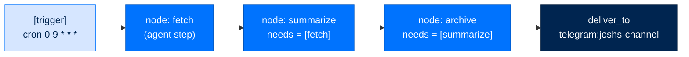

# Workflows & Schedules

> **Get Started**  ·  Set up & tune  
> **You'll finish with:** an understanding of the two ways Arc does work over time — the task board an agent runs on its own, and signed ArcFlow workflows that fire on a schedule and deliver their results to a fixed channel.  
> **Before this:** [Your First Agent](first-agent.md)  
> [Docs home](../README.md)

---

## What you'll achieve

Not everything is a chat turn. Some work is a list an agent grinds through; some
work fires at 9am whether or not anyone's watching. This page covers both: the
**tasks** module (Mission Control) and **ArcFlow** (signed, multi-step workflow
DAGs with cron triggers). By the end you can enable autonomous task dispatch and
create a workflow that runs on a schedule and posts its summary to a channel you
pin.

---

## Two kinds of "does work over time"

| | Tasks (Mission Control) | ArcFlow workflows |
|---|---|---|
| Unit | a single task row (`backlog → todo → in_progress → done`) | a signed DAG of nodes (`workflow.toml`) |
| Who drives it | one agent's own dispatch loop | the `WorkflowRunner` ticking a frontier |
| Fires on | assignment / claim | a `cron` / `interval` / `manual` trigger |
| Best for | a queue of independent jobs, retries, hand-offs | a fixed multi-step process (ingest → summarize → deliver) |

---

## Tasks — Mission Control

The tasks module gives an agent a durable task list — its own, plus the team
backlog. A task created by an agent tool, the `arc task` CLI, or the dashboard
kanban is the **same row** all three read and write.

> **It's off by default, and autonomy is a second opt-in.** Loading the module
> exposes the tools; it does **not** make an agent run work on its own. Running
> assigned work autonomously is agency the operator grants deliberately.

```toml
[modules.tasks]
enabled = true

[modules.tasks.config]
dispatch = false            # opt into autonomously running the agent's own ready tasks
default_max_attempts = 3    # retry ceiling on tasks this agent creates
retry_backoff_seconds = 30.0
task_timeout_seconds = 0.0  # 0 = unbounded
routing = true              # auto-route ownerless tasks to the best eligible agent
notify = true               # operator alerts on key transitions
```

With `dispatch = true`, a background loop claims the agent's highest-priority
ready task (dependencies met, backoff elapsed), pins a `run_id`, and runs it
under a reliability wrapper — retry with exponential backoff, wall-clock timeout,
stuck-task reclaim on restart, and dead-letter after `max_attempts`. One task in
progress at a time, per agent.

Operate the board from the CLI (writes are operator-gated by `--actor` and
audited):

```bash
arc task create "Draft the Q3 report" --actor @lead --priority high   # unowned → team backlog
arc task create "Ship it" --actor @lead --owner @analyst-1            # assigned at creation
arc task list --scope mine --actor @analyst-1                        # omit --scope for the team view
arc task assign <id> @analyst-1 --actor @lead
arc task complete <id> --actor @analyst-1 --resolution "done"
arc task talk <id> "any update?" --actor @lead                       # steer an in-progress owner
```

Edit an *at-rest* task with `arc task edit`; it refuses an `in_progress` task
(steer it with `arc task talk`, don't edit it underneath the run). The same rows
are on the dashboard's Tasks board (operator role).

---

## ArcFlow — signed workflows on a schedule

An ArcFlow workflow is a `workflow.toml` document: a small DAG of nodes, each a
bounded step, run in dependency order by a single runner. The document is
**signed** — the DAG the runner advances is exactly the DAG the operator approved,
and a model can't rewrite it mid-run.



A workflow document, in outline:

```toml
id = "nightly-meeting-ingest"
version = 1
owner = "agent://josh_agent"
channel = "work"

[trigger]
type = "cron"
expression = "0 9 * * *"      # every day at 09:00

[[node]]
id = "fetch"
kind = "agent"
agent = "josh_agent"
prompt = "prompts/fetch.md"   # a file-referenced prompt

[[node]]
id = "summarize"
kind = "agent"
agent = "josh_agent"
needs = ["fetch"]             # dependency edge; runs after fetch reaches done
prompt = "prompts/summarize.md"
deliver_to = "telegram:joshs-channel"   # pin this node's summary to a channel
```

Key fields:

- **`[trigger]`** — `type = "cron"` with a cron `expression`, `"interval"` with
  `interval_s`, or `"manual"`. A cron trigger materializes an **owner-scoped
  schedule**; the runner ticks the frontier and narrates progress to the team
  channel.
- **`needs`** — a node's dependency list. A node runs once every named upstream
  reaches `done` (or `skipped`). A skipped upstream skips the node too. A workflow
  is a DAG, and a node may not need
  nodes from two exclusive routes of one router. Retry a failed node with
  `arc workflow retry <run> <node>`; finished nodes never run again.
- **`on_failure`** — what a failed node does to the run: `fail_run` (default:
  the run fails with the node's error and every node that never ran is marked
  `cancelled` with the reason), `continue` (dependents run and are told what
  failed; not allowed on a gate or router), or `skip_dependents` (descendants are
  `skipped` with the reason and the run ends `done_with_failures`).
- **Node kinds** — `agent` (a bounded agent run with a file-referenced `prompt`),
  `tool`, `script`, `router`, `gate`, `human_input`.
- **`deliver_to`** — the important one for scheduled work. A cron run arrives on
  **no** channel, so a node's `notify_user` would fall back to whatever chat the
  operator last used — often the wrong one. Pinning `deliver_to =
  "platform:chat_id"` in the *signed* document makes the summary land on the same
  channel every time, and a model cannot redirect it. It's a gateway target like
  `telegram:12345`, or a team channel written `channel://<name>`, which posts the
  run's final text onto that arcteam channel.

### Start from a template, test, sign, run

Four starter templates ship with Arc: `intake_specialist`, `fanout_synthesize`,
`maker_checker`, and `scheduled_watcher`. Copy one in as an unsigned draft, try it
safely, sign it, then run it:

```bash
arc workflow templates                                # the starters and what each is for
arc workflow new weekly-brief --from fanout_synthesize --owner @analyst-1   # copy one in as a draft
arc workflow test weekly-brief                        # try the draft: state-modifying work is stubbed
arc workflow sign weekly-brief                        # sign the registered bundle, by id
arc workflow run weekly-brief --input in.json --detach   # run it now
```

`--owner` names the agent whose handle runs each node that does not name its own. The
templates ship with a placeholder owner (`@operator`) that no agent answers to, so
always pass the handle of a real agent. `sign`, `test` and `run` refuse a workflow still owned by
the placeholder. Fix an existing draft with one command: `arc workflow edit weekly-brief --owner
@analyst-1` (add `--node <id>` to set one node's agent instead). The dashboard asks for an owner
when you create a workflow, and lets you change it on the draft.

`sign` and `verify` take a workflow **id**, not a path. They act on the bundle the
runner reads (under your Arc home's `workflows/` directory), and refuse any path that
resolves outside it. A vault-held operator key signs the same way an on-disk one does.

A **test run** is the one way to try a draft before it is signed, at any tier. Tools
and scripts that change something are replaced by a recorded echo of the call, agent
nodes run under a small cost cap, the run is audited as `workflow.test_run`, and
nothing a schedule or an agent does can start it.

### Create, edit, inspect, resolve gates

```bash
arc workflow create ./nightly-meeting-ingest/         # validate + register a document
arc workflow list                                     # registered workflows
arc workflow show nightly-meeting-ingest              # one workflow's detail
arc workflow serve                                    # tick schedules continuously
arc workflow cancel <run_id>
arc workflow verify nightly-meeting-ingest            # check the signature
arc workflow gate <task_id> approve|reject|revise     # decide a waiting gate
```

A run that reaches a `gate` node waits for a human. Decide it from the CLI with
`arc workflow gate`, from the dashboard, or from chat with
`/gate <task_id> approve|reject|revise [notes]`. All three call the same control-plane
operation and record who decided.

When a signature request is waiting in Approvals, the card shows why it was raised and
a diff of the draft against the last signed version (nodes added, removed, and changed,
plus each prompt or schema file).

Every `arc workflow` verb takes `--dir` to point at a config directory other than
the default. Validation runs inside `create`/`edit`, so there's no separate
`validate` verb.

### Events: start a run from outside

An outside app can start a run by firing a named event. The workflow declares each
event in the signed document:

```toml
[[event]]
name = "ticket_opened"
schema = "schemas/ticket_opened.json"   # a JSON Schema file in the bundle
```

- **`name`** matches `^[a-z][a-z0-9_]{0,63}$`. It is part of the URL, so it is
  never a path. Two events may not share a name.
- **`schema`** is a file in the workflow bundle. The event payload must pass it
  before a run exists. A payload that fails gets a 422 that names every bad field.
- **At most 32** `[[event]]` tables per workflow.
- **Signed with the bundle.** The event names and their schema files are part of
  the signed content. Change one and you must sign again. A workflow with no
  events signs exactly as before.
- **Fire it** with `POST /api/workflows/{id}/events/{name}`. See
  [Work intake and events API](../reference/work-intake-api.md#fire-a-workflow-event).

An event the signed document does not declare is refused. The run input always
carries a reserved key, `arc_trigger`, set by the runner:
`{"kind": "manual" | "cron" | "interval" | "event", "name": <event name or null>}`.
A caller that sends `arc_trigger` is refused, not overwritten. No input or event
schema may claim that key.

### Human steps: `gate` and `human_input`

Both nodes stop the run until a person acts. Neither can be resolved by a tool.
Only the control plane resolves them: the HTTP route, the CLI, the dashboard, or a
chat card.

```toml
[[node]]
id = "review"
kind = "gate"
gate = "refund-approval"
needs = ["draft"]
approvers = ["role:finance"]        # DIDs, or role:<name>. Empty means operator only.
output_schema = "schemas/review.json"   # optional: the payload an approver sends
timeout_s = 3600
on_timeout = "escalate"
escalate_to = "role:finance_lead"

[[node]]
id = "ask"
kind = "human_input"
prompt = "Which region should we ship from?"   # 1 to 4000 characters
output_schema = "schemas/region.json"          # required
approvers = ["role:ops"]
```

`human_input` fields:

- **`prompt`** is what the person sees.
- **`output_schema`** is required. The person's answer must pass it.
- **`approvers`** works as on a gate.

Decisions the route accepts:

| Node | Decision words |
|---|---|
| `gate` | `approve`, `fail_run`, `return_for_revision` |
| `human_input` | `submit`, `fail_run` |

A gate may also set `output_schema`. Then the `approve` call carries a `payload`
that must pass the schema. A payload over 64 KiB is refused with 413. A bad payload
is a 422 with one issue per field, and the node keeps waiting.

#### The output envelope

A settled human step writes one `output` with exactly these keys:

| Key | Meaning |
|---|---|
| `decision` | `approved`, `rejected`, `returned_for_revision`, or `submitted` |
| `notes` | The text the person sent. May be empty |
| `payload` | The checked answer. `{}` for a decision that carries none |
| `decided_by` | The DID of who decided. The runner itself, on a timeout |
| `on_behalf_of` | The person, when an app relayed the call. Else `null` |
| `decided_at` | ISO 8601 time |
| `timed_out` | `true` when a passed deadline settled the step |

Later nodes read a field with `$nodes.<id>.output.payload.<field>`. The runner reads
the decision from the same envelope. There is no second copy.

#### Timeouts

| Field | Meaning |
|---|---|
| `timeout_s` | Seconds to wait. Must be above 0. Stamped as an absolute deadline when the node starts waiting |
| `on_timeout` | `fail` (default), `continue`, or `escalate`. `continue` and `escalate` need `timeout_s` |
| `escalate_to` | Required with `escalate`, and allowed only then |

What a passed deadline does:

- **`fail`** — the node fails with decision `rejected`. The run follows `on_failure`.
- **`continue`** — the node finishes as `approved` (gate) or `submitted`
  (`human_input`), with `payload = {}`. So `{}` must pass the `output_schema`.
  Validation refuses the document if it does not.
- **`escalate`** — one escalation step. At the first deadline, `escalate_to` is
  added as an approver and a new deadline starts. A card goes out and a
  `gate.escalated` work event is written. At the second deadline the node fails.

`escalate_to` must be a **human user DID** or `role:<name>` held by at least one
user. An agent DID is refused. A role held only by agents is refused. A decision and
a timeout racing each other cannot both win: exactly one is recorded.

### What survives a crash

The runner keeps no progress in memory, so a process can stop at any point and
the next one carries on.

- **Each node runs exactly once per attempt.** An attempt has a key: run, node,
  iteration and attempt number. A second dispatch of the same attempt runs no
  tool, script or agent turn again. A retry is a new attempt with a new key, so
  a node may run more than once across attempts. A tool that takes a dedupe
  token gets the attempt key as its `idempotency_key`.
- **Restart picks up where it stopped.** On start the runner reclaims any
  attempt whose process died, repairs each run's node state from the task rows,
  and continues from the frontier. A node that finished is never run again, and
  no node gets a second row.
- **Each node's state is on the run.** The run view reads it: status, attempts,
  last error, route taken, and why a node was skipped.
- **A broken connection never fails a run.** A bus timeout, a store error or a
  lost runner lease is retried every tick. A run stuck for 20 ticks in a row
  sends the operator one mail. A broken definition still fails the run, with the
  reason.

> **A workflow that reaches out to an external system on a schedule** will trip
> the trifecta gate — and no human is awake to approve it. That's exactly what a
> **scenario grant** is for: pre-approve the recurring composition, keyed by the
> workflow's `origin`. See [Policy & Tiers](policy-and-tiers.md#scenario-grants-approving-unattended-automation).

---

## Verify

```bash
arc workflow list                # your workflow is registered
arc task list --actor @lead      # the board is reachable
```

---

## Next

- **Deliver results to a chat platform** → [Gateways](gateways.md), then
  **ship it** → [Deploy](deploy.md).
- **The substrate under both** → [The Workflows](../walkthrough/09-workflows.md)
  covers the task state machine, the three timer engines, and the monotonic-progress
  rule ArcFlow runs on.
